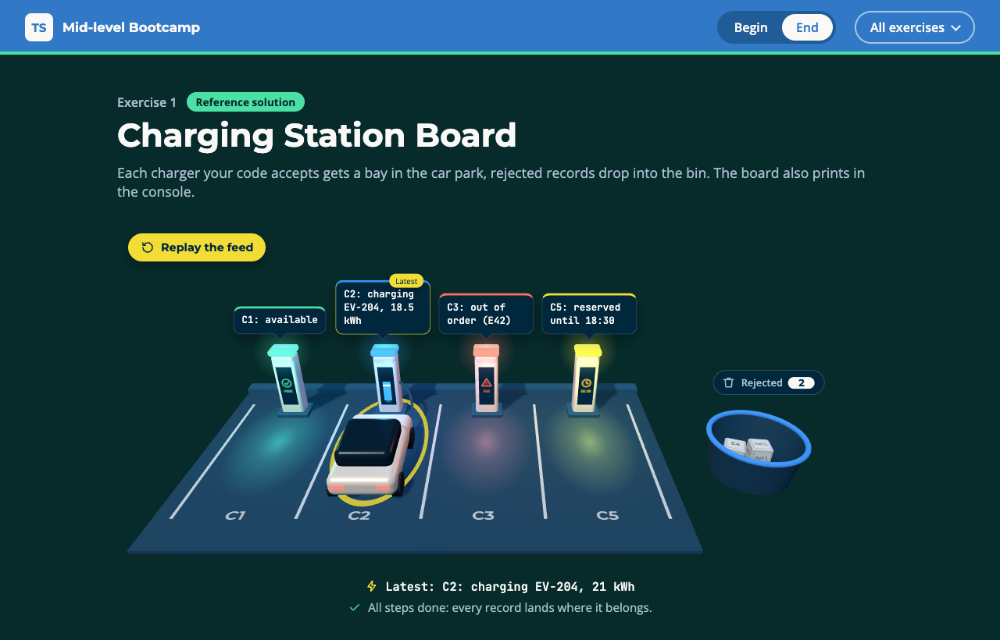

# Exercise 1 - Charging Station Board

---

⏰ 15 mins

---

<aside>
💡 If you haven’t already set up the boilerplate code, do so now with these instructions
</aside>

## What you will build

Charging stations send raw records, and some are broken. The page turns them into a car park: one bay per valid charger, a bin for the rest. You practise discriminated unions, the `never` check, a type predicate and an assertion function.

## Before you start

1. Run `npm run dev` and open `/1-begin.html` in your browser.
2. Open `src/1-begin.ts`. Each step below matches a `// Step k` comment in the file. Everything else is already written.

## Step 1 - Model the states and describe them (5 mins)

Each state should carry only its own data, so an `available` charger can never have a `vehicle`.

Replace `Charger` with a union on `status`. In `describe`, switch on `charger.status` with one `case` per state and a `never` check at the end:

```typescript
export type Charger =
  | { id: string; status: 'available' }
  | { id: string; status: 'charging' /* vehicle and kWh */ }
  | { id: string; status: 'faulted' /* code */ }

switch (charger.status) {
  case 'available':
    return `${charger.id}: available`
  // 'charging' returns `C2: charging EV-204, 18.5 kWh`
  // 'faulted' returns `C3: out of order (E42)`
  default: {
    const unhandled: never = charger
    return unhandled
  }
}
```

✅ **Check:** bay C1 shows `C1: available`, and the `step 1` tests pass (`npm test`).

## Step 2 - Check the raw records (5 mins)

The records come from outside, so you check them before you trust them.

In the given outline of `isCharger`, add a `case` for `charging` and `faulted` that checks their fields with `typeof`. Then make `assertIsCharger` throw when `isCharger` says no:

```typescript
case 'charging':
  return typeof value.vehicle === 'string' && ...
case 'faulted':
  return ...

// in assertIsCharger
if (!isCharger(value)) throw new Error('Invalid charger record')
```

<aside>
💡 HINT: `C4` is a `charging` record without `kWh`. It must land in the bin.
</aside>

✅ **Check:** C1, C2 and C3 get a bay, C4 and `null` drop into the bin, and the `step 2` tests pass.

## Step 3 - Add a state and follow the compiler (5 mins)

A new state should break the build everywhere you forgot it.

Add `{ id: string; status: 'reserved'; until: string }` to `Charger`, then run `npm run typecheck`. The `never` check points at `describe`:

```
error TS2322: Type '{ id: string; status: "reserved"; until: string; }' is not assignable to type 'never'.
```

Add the case to `describe` (`C5: reserved until 18:30`), then to `isCharger`.

<aside>
💡 HINT: The compiler trusts your predicate, so it cannot warn you about `isCharger`. Add that case yourself.
</aside>

✅ **Check:** C5 gets a bay, and the `step 3` tests pass.

## Expected result



The car park shows four bays (C1, C2, C3 and C5), two crates in the bin, and a yellow ring on C2, the latest record. The console prints:

```
C1: available
C2: charging EV-204, 18.5 kWh
C3: out of order (E42)
C5: reserved until 18:30
2 records rejected
Latest: C2: charging EV-204, 21 kWh
```

Run `npm test`: everything passes. The solution is in `src/1-end.ts`.

## Helpful Resources

1. [TypeScript Handbook - Discriminated Unions](https://www.typescriptlang.org/docs/handbook/2/narrowing.html#discriminated-unions)
2. [TypeScript Handbook - Exhaustiveness Checking](https://www.typescriptlang.org/docs/handbook/2/narrowing.html#exhaustiveness-checking)
3. [TypeScript Handbook - Using Type Predicates](https://www.typescriptlang.org/docs/handbook/2/narrowing.html#using-type-predicates)
4. [TypeScript 3.7 Release Notes - Assertion Functions](https://www.typescriptlang.org/docs/handbook/release-notes/typescript-3-7.html#assertion-functions)
