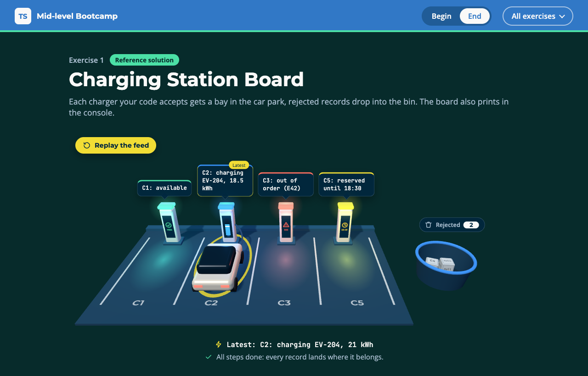

# Exercise 1 - Charging Station Board

---

**⏰ 10 min**

---

<aside>
💡 **Tip:** If you haven’t already set up the boilerplate code, do so now with these instructions.
</aside>

1. Open the following file: `/1-begin.html`

## Goal

Charging stations send raw records, and some are broken. Every valid charger gets a bay, the rest drop into the bin. The runtime code is written: you only write the types that make it safe. Edit `src/1-begin.ts`.

## Step 1 - Add a state (3 min)

Add the `charging` state to `Charger`:

```typescript
| { id: string; status: 'charging'; vehicle: string; kWh: number }
```

The `never` check in `describe` now fails: `error TS2322: Type '{ id: string; status: "charging"; vehicle: string; kWh: number; }' is not assignable to type 'never'.` Add the missing case:

```typescript
case 'charging':
  return `${charger.id}: charging ${charger.vehicle}, ${charger.kWh} kWh`
```

✅ **Check:** bay C2 shows `C2: charging EV-204, 18.5 kWh`.

## Step 2 - Predicate and assertion (3 min)

Hover `valid` at the bottom of the file: `unknown[]`. Change two return types, and add the throw:

```typescript
export function isCharger(value: unknown): value is Charger {

export function assertIsCharger(value: unknown): asserts value is Charger {
  if (!isCharger(value)) throw new Error('Invalid charger record')
```

✅ **Check:** `valid` is now a `Charger[]`, and the page says “Waiting for step 3”.

## Step 3 - Follow the compiler (4 min)

Add the `reserved` state:

```typescript
| { id: string; status: 'reserved'; until: string }
```

The `never` check points at `describe` again. Add the case there, then in `isCharger`:

```typescript
case 'reserved':
  return `${charger.id}: reserved until ${charger.until}`

case 'reserved':
  return typeof value.until === 'string'
```

<aside>
💡 **Hint:** The compiler trusts your predicate, so it cannot tell you about `isCharger`.
</aside>

✅ **Check:** C5 gets a bay, the page says “All steps done”, and `npm test` passes.

## Expected result



Four bays (C1, C2, C3, C5), two crates in the bin, a yellow ring on C2. The solution is in `src/1-end.ts`.

## Helpful Resources

1. [TypeScript Handbook - Discriminated Unions](https://www.typescriptlang.org/docs/handbook/2/narrowing.html#discriminated-unions)
2. [TypeScript Handbook - Exhaustiveness Checking](https://www.typescriptlang.org/docs/handbook/2/narrowing.html#exhaustiveness-checking)
3. [TypeScript Handbook - Using Type Predicates](https://www.typescriptlang.org/docs/handbook/2/narrowing.html#using-type-predicates)
4. [TypeScript 3.7 Release Notes - Assertion Functions](https://www.typescriptlang.org/docs/handbook/release-notes/typescript-3-7.html#assertion-functions)
