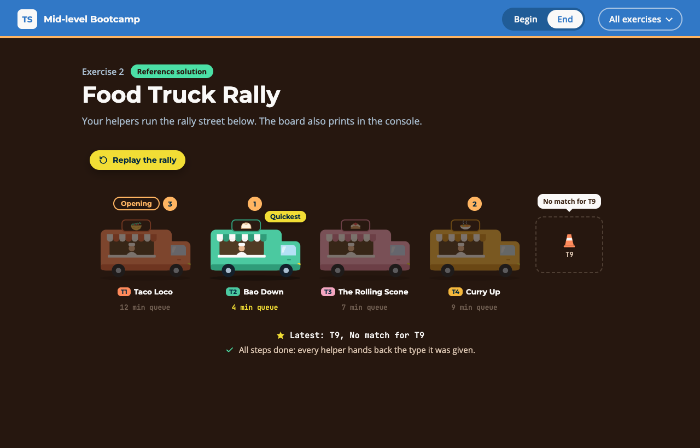

# Exercise 2 - Food Truck Rally

---

**⏰ 10 min**

---

<aside>
💡 **Tip:** If you haven’t already set up the boilerplate code, do so now with these instructions.
</aside>

1. Open the following file: `/2-begin.html`

## Goal

The board of a weekend food truck rally. The function bodies already work: you only change their types, with a generic constraint, a default type parameter and a `const` type parameter. Edit `src/2-begin.ts`.

## Step 1 - Make `quickest` generic (4 min)

Hover `fastDish`: `{ minutes: number } | undefined`. The dish is lost. Make `quickest` generic:

```typescript
export function quickest<T extends { minutes: number }>(items: readonly T[]): T | undefined {
  let best: T | undefined
```

Try `<T>` alone first: `error TS2339: Property 'minutes' does not exist on type 'T'.` The constraint asks for what the body reads, nothing more.

✅ **Check:** `fastDish` is a `Dish | undefined`, and Bao Down gets its “Quickest” badge.

## Step 2 - A default for `Lookup` (3 min)

Add an error type `E`, with `string` as its default:

```typescript
export type Lookup<T, E = string> = { found: true; value: T } | { found: false; error: E }
```

Without `= string`, `findById` breaks: `error TS2314: Generic type 'Lookup' requires 2 type argument(s).`

✅ **Check:** “No match for T9” shows over the empty spot.

## Step 3 - Keep the exact stops (3 min)

Hover `tour`: `string[]`. Add one keyword:

```typescript
export function route<const T extends readonly string[]>(stops: T): T {
```

✅ **Check:** `tour` is `readonly ["T2", "T4", "T1"]`, the stops are numbered 1 to 3, and `npm test` passes.

## Expected result



The whole street lights up: the "Quickest" badge on Bao Down, "No match for T9" over the empty spot, and the tasting stops numbered 1 to 3. The solution is in `src/2-end.ts`.

## Helpful Resources

1. [TypeScript Handbook - Generics](https://www.typescriptlang.org/docs/handbook/2/generics.html)
2. [TypeScript Handbook - Generic Constraints](https://www.typescriptlang.org/docs/handbook/2/generics.html#generic-constraints)
3. [TypeScript Handbook - Generic Parameter Defaults](https://www.typescriptlang.org/docs/handbook/2/generics.html#generic-parameter-defaults)
4. [TypeScript 5.0 Release Notes - const Type Parameters](https://www.typescriptlang.org/docs/handbook/release-notes/typescript-5-0.html#const-type-parameters)
