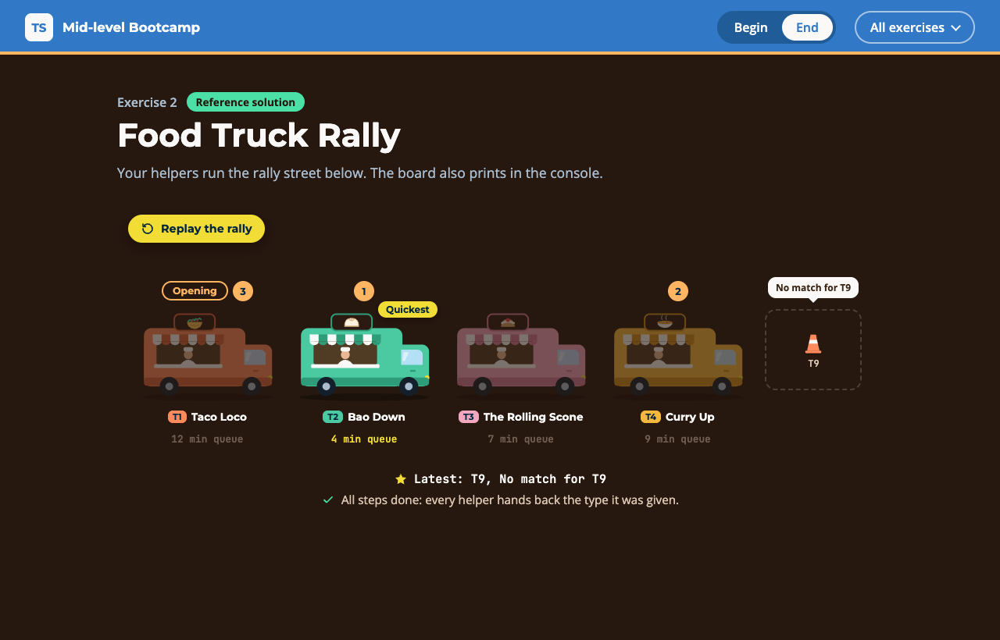

# Exercise 2 - Food Truck Rally

---

⏰ 15 mins

---

<aside>
💡 If you haven’t already set up the boilerplate code, do so now with these instructions
</aside>

## What you will build

The board of a weekend food truck rally. You replace `any` in three helpers with generics: a constraint, a default and a `const` type parameter. Each step lights up part of the rally street.

## Before you start

1. Run `npm run dev` and open `/2-begin.html` in your browser.
2. Open `src/2-begin.ts`. Each step below matches a `// Step k` comment in the file. Everything else is already written.

The data has three types:

```typescript
type Truck = { id: string; name: string; minutes: number } // minutes: the queue
type Dish = { id: string; name: string; minutes: number } // minutes: the preparation time
type Volunteer = { id: string; name: string } // no minutes
```

`first` is given: its type parameter `T` links the list to the result. The bodies already work, so you only write types.

## Step 1 - Constrain `quickest` (6 mins)

A constraint lets a generic body read a property, and callers still get their own type back.

Add `<T>` and replace every `any` with `T` (`T | undefined` for `let best`). The compiler stops you:

```
error TS2339: Property 'minutes' does not exist on type 'T'.
```

Constrain `T` to what the body reads, nothing more:

```typescript
export function quickest<T extends ...>(items: readonly T[]): T | undefined
```

<aside>
💡 HINT: The body only reads `minutes`, so the constraint has one property.
</aside>

✅ **Check:** `fastDish` in `report` is a `Dish | undefined`, Bao Down gets its "Quickest" badge, and the `step 1` tests pass (`npm test`).

## Step 2 - Add a default to `Lookup` (4 mins)

A default keeps the common case short, but allows another type.

Add a second type parameter `E`, defaulting to `string`, and use it for `error`:

```typescript
export type Lookup<T, E = ...> =
  | { found: true; value: T }
  | { found: false; error: ... }
```

✅ **Check:** "No match for T9" shows over the empty spot, and the `step 2` tests pass.

## Step 3 - Keep the exact stops in `route` (5 mins)

A `const` type parameter keeps literals, so callers skip `as const`.

Give `route` this signature, then hover the `route([...])` call in `report`:

```typescript
export function route<T extends readonly string[]>(stops: T): T
```

It shows `string[]`. Add one keyword before `T` so it becomes `readonly ["T2", "T4", "T1"]`.

<aside>
💡 HINT: It is the keyword from `as const`. No `any`, `as` or `@ts-ignore`: the tests look for them.
</aside>

✅ **Check:** stops 1, 2 and 3 appear on Bao Down, Curry Up, then Taco Loco, and the `step 3` tests pass.

## Expected result



The whole street lights up. The console prints:

```
Opening truck: Taco Loco
Shortest queue: Bao Down, 4 min
Fastest dish: Cream tea, 2 min
T9: No match for T9
Tasting route: Bao Down > Curry Up > Taco Loco
```

Run `npm test`: everything passes. The solution is in `src/2-end.ts`.

## Helpful Resources

1. [TypeScript Handbook - Generics](https://www.typescriptlang.org/docs/handbook/2/generics.html)
2. [TypeScript Handbook - Generic Constraints](https://www.typescriptlang.org/docs/handbook/2/generics.html#generic-constraints)
3. [TypeScript Handbook - Generic Parameter Defaults](https://www.typescriptlang.org/docs/handbook/2/generics.html#generic-parameter-defaults)
4. [TypeScript 5.0 Release Notes - const Type Parameters](https://www.typescriptlang.org/docs/handbook/release-notes/typescript-5-0.html#const-type-parameters)
