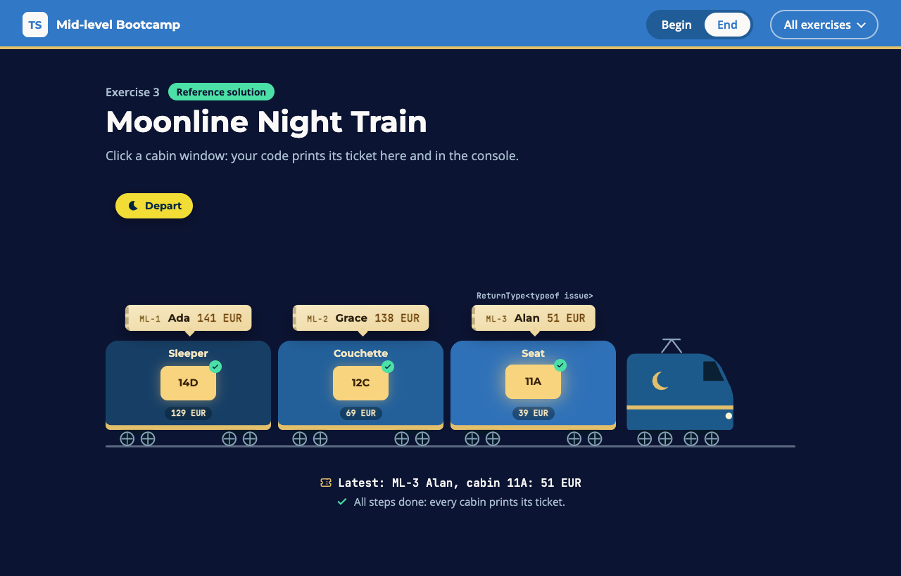

# Exercise 3 - Moonline Night Train

---

⏰ 15 mins

---

<aside>
💡 If you haven’t already set up the boilerplate code, do so now with these instructions
</aside>

## What you will build

You run the booking desk of the Moonline night train. Once you are done, every cabin window on the page prints its ticket. You practise deriving types with `as const`, `satisfies`, `typeof`, `keyof` and utility types, so they can never drift.

## Before you start

1. Run `npm run dev` and open `/3-begin.html` in your browser.
2. Open `src/3-begin.ts`. Each step below matches a `// Step k` comment in the file. Everything else is already written.

## Step 1 - Freeze the classes, check the fares (5 mins)

A missing fare should be a compile error, not a surprise on the train.

Add `as const` to `cabinClasses` and derive `CabinClass` from it. Then add `satisfies` after `fares`:

```typescript
export const cabinClasses = ['seat', 'couchette', 'sleeper'] as const
export type CabinClass = (typeof cabinClasses)[number]

export const fares = { ... } satisfies Record<CabinClass, number>
```

`npm run typecheck` now names the fare you forgot:

```
error TS2741: Property 'sleeper' is missing in type '{ seat: number; couchette: number; }' but required in type 'Record<"couchette" | "seat" | "sleeper", number>'.
```

Add `sleeper: 129`.

✅ **Check:** hover `CabinClass`: it is `'seat' | 'couchette' | 'sleeper'`. The page now waits for step 3, and the `step 1` tests pass (`npm test`).

## Step 2 - Derive the booking types (5 mins)

Hand-written copies do not follow when `Booking` changes.

Replace `BookingRequest` and `Ticket` with one line each: a `Booking` without its `id`, and what `issue` returns, made read-only.

```typescript
export type BookingRequest = Omit<Booking, ...>
export type Ticket = Readonly<ReturnType<...>>
```

<aside>
💡 HINT: `ReturnType` takes a function type, not a function. Use `typeof issue`.
</aside>

✅ **Check:** the `step 2` tests pass.

## Step 3 - Derive the cabin ids, price the ticket (5 mins)

The `Record<string, Cabin>` annotation throws away the cabin ids, so any string counts as a cabin.

Swap the annotation for `satisfies`, derive `CabinId` from the keys, then set `perNight` in `fare`.

```typescript
export const cabins = { ... } satisfies Record<string, Cabin>
export type CabinId = keyof typeof cabins

const perNight = fares[cabins[booking.cabin].class]
```

<aside>
💡 HINT: with the old annotation, `cabins[booking.cabin]` fails with `Object is possibly 'undefined'.` With `CabinId`, every cabin exists.
</aside>

✅ **Check:** hover `CabinId`: it is `'11A' | '12C' | '14D'`. Every cabin window prints its ticket, and the `step 3` tests pass.

## Expected result



Each cabin window slides out a one-line ticket, and the latest one is tagged with the type it comes from, `ReturnType<typeof issue>`. The console prints:

```
Moonline 1407, Paris Est 19:42 to Wien Hbf 09:58
ML-1 Ada, cabin 14D: 141 EUR
ML-2 Grace, cabin 12C: 138 EUR
ML-3 Alan, cabin 11A: 51 EUR
Total: 330 EUR
```

Run `npm test`: everything passes. The solution is in `src/3-end.ts`.

## Helpful Resources

1. [TypeScript Handbook - Keyof Type Operator](https://www.typescriptlang.org/docs/handbook/2/keyof-types.html)
2. [TypeScript Handbook - Typeof Type Operator](https://www.typescriptlang.org/docs/handbook/2/typeof-types.html)
3. [TypeScript Handbook - Indexed Access Types](https://www.typescriptlang.org/docs/handbook/2/indexed-access-types.html)
4. [TypeScript Handbook - Utility Types](https://www.typescriptlang.org/docs/handbook/utility-types.html)
5. [TypeScript 4.9 Release Notes - The satisfies Operator](https://www.typescriptlang.org/docs/handbook/release-notes/typescript-4-9.html#the-satisfies-operator)
