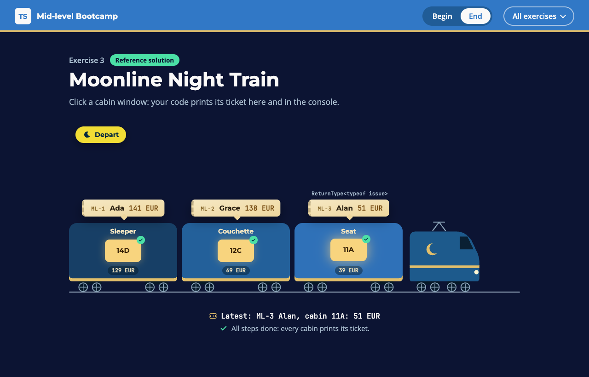

# Exercise 3 - Moonline Night Train

---

**⏰ 10 min**

---

<aside>
💡 **Tip:** If you haven’t already set up the boilerplate code, do so now with these instructions.
</aside>

1. Open the following file: `/3-begin.html`

## Goal

You run the booking desk of the Moonline night train. The data and the logic are written: you derive the types from them with `as const`, `satisfies`, `typeof`, `keyof` and utility types, so they can never drift. Edit `src/3-begin.ts`.

## Step 1 - Freeze the classes, check the fares (3 min)

Hover `CabinClass`: `string`. Add `as const` to the array, then `satisfies` to the fares:

```typescript
export const cabinClasses = ['seat', 'couchette', 'sleeper'] as const

export const fares = { seat: 39, couchette: 69 } satisfies Record<CabinClass, number>
```

`error TS2741: Property 'sleeper' is missing in type '{ seat: number; couchette: number; }' but required in type 'Record<"couchette" | "seat" | "sleeper", number>'.` Add `sleeper: 129`.

✅ **Check:** the page moves on to “Waiting for step 3”.

## Step 2 - Derive the booking types (3 min)

Replace the two hand-written copies:

```typescript
export type BookingRequest = Omit<Booking, 'id'>
export type Ticket = Readonly<ReturnType<typeof issue>>
```

✅ **Check:** `npm run typecheck` is clean.

## Step 3 - Price the ticket (4 min)

Replace `0` in `fare` with the price per night:

```typescript
return total(fares[cabins[booking.cabin].class], booking)
```

`error TS2532: Object is possibly 'undefined'.` The annotation `Record<string, Cabin>` forgot the cabin ids. Swap it for `satisfies`, and derive the ids:

```typescript
export const cabins = {
  // ...
} satisfies Record<string, Cabin>

export type CabinId = keyof typeof cabins
```

✅ **Check:** every cabin window prints its ticket, the page says “All steps done”, and `npm test` passes.

## Expected result



Each cabin window slides out a one-line ticket, and the total is 330 EUR. The solution is in `src/3-end.ts`.

## Helpful Resources

1. [TypeScript Handbook - Keyof Type Operator](https://www.typescriptlang.org/docs/handbook/2/keyof-types.html)
2. [TypeScript Handbook - Typeof Type Operator](https://www.typescriptlang.org/docs/handbook/2/typeof-types.html)
3. [TypeScript Handbook - Indexed Access Types](https://www.typescriptlang.org/docs/handbook/2/indexed-access-types.html)
4. [TypeScript Handbook - Utility Types](https://www.typescriptlang.org/docs/handbook/utility-types.html)
5. [TypeScript 4.9 Release Notes - The satisfies Operator](https://www.typescriptlang.org/docs/handbook/release-notes/typescript-4-9.html#the-satisfies-operator)
