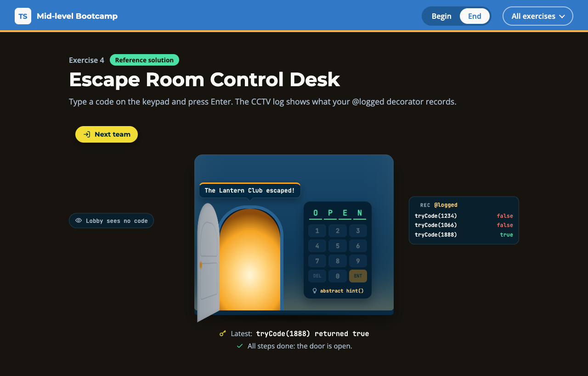

# Exercise 4 - Escape Room Control Desk

---

⏰ 15 mins

---

<aside>
💡 If you haven’t already set up the boilerplate code, do so now with these instructions
</aside>

## What you will build

You run the control desk of an escape room. Once you are done, the lobby screen no longer shows the secret code, and a CCTV log next to the door lists every code a team tries. You practise privacy, abstract classes and a typed decorator.

## Before you start

1. Run `npm run dev` and open `/4-begin.html` in your browser.
2. Open `src/4-begin.ts`. Each step below matches a `// Step k` comment in the file. Everything else is already written, including the generic `Waitlist` and the `isOccupied` guard: read their `Given` comments.

## Step 1 - Hide the team and the code (5 mins)

`private` is only checked by the compiler, so `JSON.stringify` still sends the code to the lobby screen.

In `Team`, delete the two fields and the two assignments, and declare them in the constructor. Then in `Room`, replace `private code` with a `#code` field.

```typescript
constructor(
  readonly name: string,
  readonly players: number,
) {}
```

<aside>
💡 HINT: A `#` field cannot be a parameter property: `error TS18009: Private identifiers cannot be used as parameters.` Declare `#code: string` in the class body, and assign `this.#code = code` in the constructor.
</aside>

✅ **Check:** the "Waiting for step 1" card disappears, and the `step 1` tests pass (`npm test`).

## Step 2 - Make Room abstract (4 mins)

Nobody should create a plain `Room`, and every room must write its own hint.

Make the class abstract, make it implement `Resettable`, and turn `hint()` into an abstract method with no body.

```typescript
export abstract class Room implements Resettable {
  // ...
  abstract hint(): string
```

✅ **Check:** the Hint link on the keypad turns into `abstract hint()`, and clicking it shows the Attic's own hint instead of the generic one. The `step 2` tests pass.

## Step 3 - Log every attempt with a decorator (6 mins)

A decorator adds the audit to `tryCode` without touching its body or its type.

The signature of `logged` is typed for you. Replace `return method` with a wrapper that calls the method, pushes one line into `audit` and returns the result. Then write `@logged` on the line above `tryCode`.

```typescript
return function (this: This, ...args: Args): Return {
  const result = method.apply(this, args)
  audit.push(`${this.name}: ${String(context.name)}(${args.join(', ')}) returned ${String(result)}`)
  return ...
}
```

✅ **Check:** the CCTV log shows the two attempts, and the `step 3` tests pass.

## Expected result



The plaque shows The Lantern Club inside, the lobby sees no code, and the CCTV lists both attempts. Type `1888` and press Enter: the door opens. In the console:

```
Clockmaker's Attic: The Lantern Club, hint "The year is on the pendulum"
Pharaoh's Vault: free, lobby shows {"name":"Pharaoh's Vault","attempts":0}
Waiting: Night Owls
Clockmaker's Attic: tryCode(1234) returned false
Clockmaker's Attic: tryCode(1066) returned false
```

Run `npm test`: everything passes. The solution is in `src/4-end.ts`.

## Helpful Resources

1. [TypeScript Handbook - Classes: Parameter Properties](https://www.typescriptlang.org/docs/handbook/2/classes.html#parameter-properties)
2. [TypeScript Handbook - Classes: Caveats (private and #private)](https://www.typescriptlang.org/docs/handbook/2/classes.html#caveats)
3. [TypeScript Handbook - Classes: abstract Classes and Members](https://www.typescriptlang.org/docs/handbook/2/classes.html#abstract-classes-and-members)
4. [TypeScript Handbook - Classes: this-based type guards](https://www.typescriptlang.org/docs/handbook/2/classes.html#this-based-type-guards)
5. [TypeScript 5.0 Release Notes - Decorators](https://www.typescriptlang.org/docs/handbook/release-notes/typescript-5-0.html#decorators)
