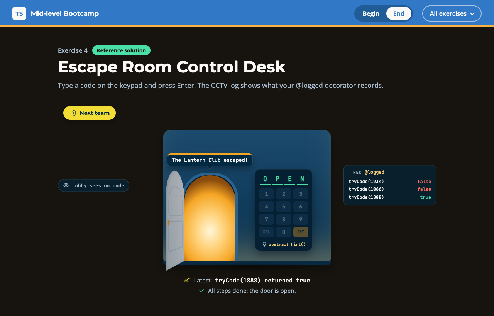

# Exercise 4 - Escape Room Control Desk

---

**⏰ 10 min**

---

<aside>
💡 **Tip:** If you haven’t already set up the boilerplate code, do so now with these instructions.
</aside>

1. Open the following file: `/4-begin.html`

## Goal

You run the control desk of an escape room. The lobby screen must not show the secret code, every room must write its own hint, and a CCTV log lists every code a team tries. You practise real private fields, abstract classes and a typed decorator.

Edit `src/4-begin.ts`. Each step matches a `// Step k` comment. `RoomBase` is given: it holds the team, counts the attempts and resets the room.

## Step 1 - Hide the code (3 min)

`private` is only checked by the compiler: at runtime the field is still there, so `JSON.stringify` sends it to the lobby screen. Use a `#` field instead, in its three places:

```typescript
#code: string

this.#code = code

return code === this.#code
```

✅ **Check:** the lobby says “Lobby sees no code”.

## Step 2 - Make Room abstract (3 min)

Nobody should create a plain `Room`, and every room must write its own hint:

```typescript
import { type Resettable, RoomBase, audit } from './_internal/escape-room'

export abstract class Room extends RoomBase implements Resettable {
  // ...
  abstract hint(): string
```

✅ **Check:** the Hint link on the keypad turns into `abstract hint()`. Click it: the Attic gives its own hint.

## Step 3 - Log every attempt with a decorator (4 min)

In `logged`, return a wrapper that calls the method, writes one line into `audit`, and returns the result:

```typescript
return function (this: This, ...args: Args): Return {
  const result = method.apply(this, args)
  audit.push(`${this.name}: ${String(context.name)}(${args.join(', ')}) returned ${String(result)}`)
  return result
}
```

Then put `@logged` on the line above `tryCode`.

✅ **Check:** the CCTV log shows the two attempts, and `npm test` passes.

## Expected result



The plaque shows The Lantern Club inside, the lobby sees no code, and the CCTV lists both attempts. Type `1888` and press Enter: the door opens. The solution is in `src/4-end.ts`.

## Helpful Resources

1. [TypeScript Handbook - Classes: Parameter Properties](https://www.typescriptlang.org/docs/handbook/2/classes.html#parameter-properties)
2. [TypeScript Handbook - Classes: Caveats (private and #private)](https://www.typescriptlang.org/docs/handbook/2/classes.html#caveats)
3. [TypeScript Handbook - Classes: abstract Classes and Members](https://www.typescriptlang.org/docs/handbook/2/classes.html#abstract-classes-and-members)
4. [TypeScript Handbook - Classes: this-based type guards](https://www.typescriptlang.org/docs/handbook/2/classes.html#this-based-type-guards)
5. [TypeScript 5.0 Release Notes - Decorators](https://www.typescriptlang.org/docs/handbook/release-notes/typescript-5-0.html#decorators)
