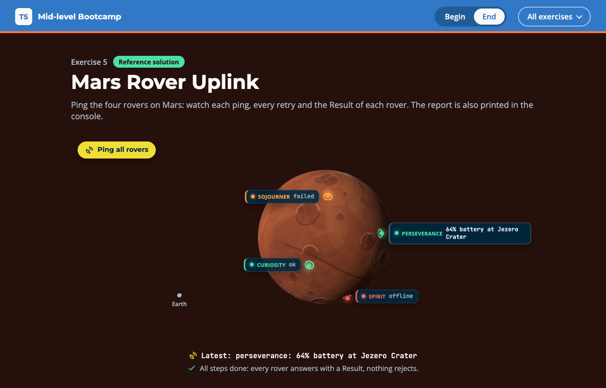

# Exercise 5 - Mars Rover Uplink

---

**⏰ 10 min**

---

<aside>
💡 **Tip:** If you haven’t already set up the boilerplate code, do so now with these instructions.
</aside>

1. Open the following file: `/5-begin.html`

## Goal

Mission control pings four rovers on Mars, and some of them fail: a lost signal (try again), an offline rover (do not retry), or old firmware that throws plain strings. Each rover gets a report line, and nothing crashes. You practise Result types, `unknown` errors and `async` code.

Edit `src/5-begin.ts`. Each step matches a `// Step k` comment.

## Step 1 - Make Result a union (4 min)

Today a `Result` can be `ok` with no value. Make it a union:

```typescript
export type Result<T, E> =
  | { ok: true; value: T }
  | { ok: false; error: E }
```

`reportLine` breaks: `Property 'value' does not exist on type 'Result<Telemetry, string>'.` Narrow on `ok` instead:

```typescript
if (!outcome.ok) return `${rover}: ${outcome.error}`
```

✅ **Check:** `npm run typecheck` is clean again.

## Step 2 - Describe each failure (3 min)

A caught error is `unknown`. Add the two missing checks, between the given ones:

```typescript
if (err instanceof RoverOfflineError) return `offline since ${err.since}`
if (err instanceof Error) return err.message
```

✅ **Check:** the page moves on to step 3.

## Step 3 - Retry only a lost signal (3 min)

The loop retries every failure, even a rover that is gone for good. In the `catch`, before `await sleep(delay)`:

```typescript
if (!(err instanceof SignalLostError)) return { ok: false, error: describeFailure(err) }
```

✅ **Check:** spirit is pinged once, and the page says “All steps done”.

## Expected result



Each rover card ends with one word: green `ok`, red `offline` or orange `failed`. The solution is in `src/5-end.ts`.

## Helpful Resources

1. [TypeScript Handbook - Discriminated Unions](https://www.typescriptlang.org/docs/handbook/2/narrowing.html#discriminated-unions)
2. [TypeScript Handbook - instanceof narrowing](https://www.typescriptlang.org/docs/handbook/2/narrowing.html#instanceof-narrowing)
3. [TSConfig Reference - useUnknownInCatchVariables](https://www.typescriptlang.org/tsconfig/#useUnknownInCatchVariables)
4. [MDN - async function](https://developer.mozilla.org/en-US/docs/Web/JavaScript/Reference/Statements/async_function)
5. [MDN - function*](https://developer.mozilla.org/en-US/docs/Web/JavaScript/Reference/Statements/function*)
