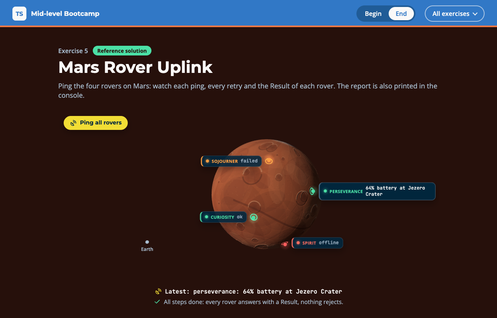

# Exercise 5 - Mars Rover Uplink

---

⏰ 15 mins

---

<aside>
💡 If you haven’t already set up the boilerplate code, do so now with these instructions
</aside>

## What you will build

Mission control pings four rovers on Mars, and some of them fail. Once you are done, each rover shows a report line and nothing crashes. You practise Result types, `unknown` errors and `async` code.

## Before you start

1. Run `npm run dev` and open `/5-begin.html` in your browser.
2. Open `src/5-begin.ts`. Each step below matches a `// Step k` comment in the file. Everything else is already written.

`network.ping(rover)` returns a `Promise<Telemetry>`. It can fail in three ways:

```typescript
// SignalLostError     no answer this time: try again
// RoverOfflineError   gone for good, with a `since` field: do not retry
// 'dust storm'        old firmware throws plain strings, not errors
```

`retryDelays` is given: a generator that yields `5`, `10`, `20` for `retryDelays(5, 3)`.

## Step 1 - Make Result a union (5 mins)

A success must carry a value and a failure an error, never both.

Turn `Result` into a union on `ok`. Then write `reportLine`: return the error on failure, the battery and site on success.

```typescript
export type Result<T, E> =
  | { ok: true; value: T }
  | ...

if (!outcome.ok) return `${rover}: ${outcome.error}`
return `${rover}: ${...}% battery at ${...}`
```

<aside>
💡 HINT: With the old type, `outcome.value.battery` fails with `'outcome.value' is possibly 'undefined'.` With the union, checking `outcome.ok` is enough.
</aside>

✅ **Check:** the page says “Waiting for step 2”, and the `step 1` tests pass (`npm test`).

## Step 2 - Describe each failure (4 mins)

A caught error is `unknown`, so you must narrow it before you read it.

Write `describeFailure` with `instanceof`, in this order:

```typescript
if (err instanceof SignalLostError) return 'signal lost'
if (err instanceof RoverOfflineError) return `offline since ${...}`
if (err instanceof Error) return ...
return `unknown failure: ${String(err)}`
```

<aside>
💡 HINT: Both error classes extend `Error`, so check them first.
</aside>

✅ **Check:** the page says “Waiting for step 3”, and the `step 2` tests pass.

## Step 3 - Retry, never reject (6 mins)

The caller always gets a `Result`, so it never needs a `try`.

Fill in the `catch` of `pingWithRetry`: if `err` is not a `SignalLostError`, return a failure with `describeFailure(err)`. Otherwise `await sleep(delay)` and let the loop try again.

```typescript
for (const delay of retryDelays(5, 3)) {
  try {
    return { ok: true, value: await network.ping(rover) }
  } catch (err) {
    // your part
  }
}
return { ok: false, error: 'signal lost' }
```

<aside>
💡 HINT: Keep the `await` inside the `try`. Without it, the compiler says `Type 'Promise<Telemetry>' is missing the following properties from type 'Telemetry': rover, battery, site`.
</aside>

✅ **Check:** perseverance pulses and shows `retry in 5 ms`, then turns green, and the `step 3` tests pass.

## Expected result



Each rover card ends with one word: green `ok`, red `offline` or orange `failed`. The rover that answered last shows its full report line, which is also the `Latest` line under Mars. The console prints:

```
curiosity: 87% battery at Gale Crater
perseverance: 64% battery at Jezero Crater
spirit: offline since sol 2210
sojourner: unknown failure: dust storm
```

Run `npm test`: everything passes. The solution is in `src/5-end.ts`.

## Helpful Resources

1. [TypeScript Handbook - Discriminated Unions](https://www.typescriptlang.org/docs/handbook/2/narrowing.html#discriminated-unions)
2. [TypeScript Handbook - instanceof narrowing](https://www.typescriptlang.org/docs/handbook/2/narrowing.html#instanceof-narrowing)
3. [TSConfig Reference - useUnknownInCatchVariables](https://www.typescriptlang.org/tsconfig/#useUnknownInCatchVariables)
4. [MDN - async function](https://developer.mozilla.org/en-US/docs/Web/JavaScript/Reference/Statements/async_function)
5. [MDN - function*](https://developer.mozilla.org/en-US/docs/Web/JavaScript/Reference/Statements/function*)
