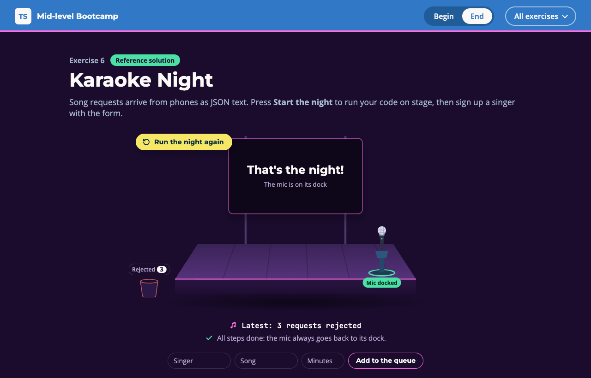

# Exercise 6 - Karaoke Night

---

**⏰ 10 min**

---

<aside>
💡 **Tip:** If you haven’t already set up the boilerplate code, do so now with these instructions.
</aside>

1. Open the following file: `/6-begin.html`

## Goal

It's karaoke night: song requests arrive as JSON text from the phones, and one mic goes from singer to singer. Broken requests drop into the bin, the mic always returns to its dock, and a form signs up a singer. You practise checking `unknown` data, `using`, and proving DOM types.

Edit `src/6-begin.ts`. Each step matches a `// Step k` comment.

## Step 1 - Check the minutes (3 min)

`singer` and `song` are already checked. Check `minutes` the same way (a number above 0), then return a new object with the three checked fields.

<aside>
💡 **Hint:** Read `value.minutes` before checking it, and the compiler stops you. Check first, then read.
</aside>

✅ **Check:** press **Start the night**: Sam, Lena and Ana drop into the bin.

## Step 2 - Give the mic back (4 min)

Priya keeps the mic, so nobody else can sing. Make the mic go back to its dock at the end of every song, even one that fails.

<aside>
💡 **Hint:** Start by borrowing the mic with `using`, then follow the compiler: `Disposable`, `Symbol.dispose`.
</aside>

✅ **Check:** Kofi's song fails, the mic still goes back to its dock, and Mo sings.

## Step 3 - Prove the input (3 min)

`querySelector` gives an `Element | null`, not an input. Prove it is an `HTMLInputElement` before you return it, otherwise throw `Missing field <selector>`. No `as`, no `!`.

✅ **Check:** sign up Ana for Mr Brightside, 4 minutes. The page says “All steps done”, and `npm test` passes.

## Expected result

Three requests in the bin, "That's the night!" on the screen, the mic back on its dock. The solution is in `src/6-end.ts`.

## Helpful Resources

1. [TypeScript 5.2 Release Notes - using Declarations and Explicit Resource Management](https://www.typescriptlang.org/docs/handbook/release-notes/typescript-5-2.html#using-declarations-and-explicit-resource-management)
2. [TypeScript Handbook - The in operator narrowing](https://www.typescriptlang.org/docs/handbook/2/narrowing.html#the-in-operator-narrowing)
3. [TypeScript Handbook - instanceof narrowing](https://www.typescriptlang.org/docs/handbook/2/narrowing.html#instanceof-narrowing)
4. [MDN - using](https://developer.mozilla.org/en-US/docs/Web/JavaScript/Reference/Statements/using)
