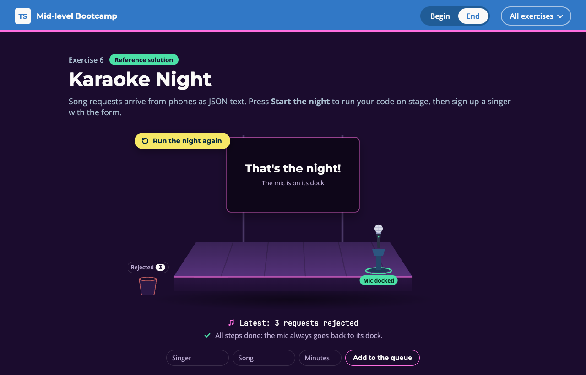

# Exercise 6 - Karaoke Night

---

⏰ 15 mins

---

<aside>
💡 If you haven’t already set up the boilerplate code, do so now with these instructions
</aside>

## What you will build

It's karaoke night: song requests arrive as JSON text, and one mic goes from singer to singer. Once you are done, broken requests drop into the bin, the mic always returns to its dock, and a form signs up a singer. You practise checking `unknown` data, `using`, and proving DOM types.

## Before you start

1. Run `npm run dev` and open `/6-begin.html` in your browser.
2. Open `src/6-begin.ts`. Each step below matches a `// Step k` comment in the file. Everything else is already written.

## Step 1 - Check the minutes (4 mins)

Data from the phones is `unknown`: check it before you trust it.

In `toSongRequest`, `singer` and `song` are already checked. Check `minutes` the same way (a number above 0), then return a new object:

```typescript
if (!('minutes' in value) || typeof value.minutes !== 'number' || ...) return null
return { singer: value.singer, song: value.song, minutes: ... }
```

<aside>
💡 HINT: If you read `value.minutes` before checking it, you get `error TS2339: Property 'minutes' does not exist on type 'object & Record<"singer", unknown> & Record<"song", unknown>'.` Check first, then read.
</aside>

✅ **Check:** press **Start the night**: three requests drop into the bin, and the `step 1` tests pass (`npm test`).

## Step 2 - Give the mic back with using (7 mins)

Kofi's song fails, and Mo still needs the mic after him.

Make `Mic` a `Disposable` whose `[Symbol.dispose]` calls `dock.giveBack()`. Then, in `perform`, borrow the mic with `using` before you call `sing`:

```typescript
export type Mic = Disposable & { singer: string }

return {
  singer,
  [Symbol.dispose]() {
    // give the mic back to the dock
  },
}

using mic = borrowMic(dock, request.singer)
```

<aside>
💡 HINT: `using` only accepts a `Disposable`. Without the new `Mic` type you get `error TS2741: Property '[Symbol.dispose]' is missing in type 'Mic' but required in type 'Disposable'.`
</aside>

✅ **Check:** the mic flies back to its dock after Kofi's failed song, Mo sings, and the `step 2` tests pass.

## Step 3 - Prove the input with instanceof (4 mins)

`querySelector` gives you `Element | null`, not an input.

In `field`, prove the element is an `HTMLInputElement` with `instanceof`. Otherwise, throw. No `as` and no `!`: a test checks it.

```typescript
if (!(element instanceof HTMLInputElement)) throw new Error(`Missing field ${selector}`)
return element
```

✅ **Check:** sign up Ana for Mr Brightside, 4 minutes, and the `step 3` tests pass.

## Expected result



Three requests sit in the bin, the screen says "That's the night!", and the mic is back on its dock. The console shows:

```
Priya sings Dancing Queen (4 min)
Skipped Kofi: No backing track for My Way
Mo sings Valerie (4 min)
3 requests rejected
```

Then sign up Ana with Mr Brightside, 4 minutes, in the form. One more line appears:

```
Ana sings Mr Brightside (4 min)
```

Run `npm test`: everything passes. The solution is in `src/6-end.ts`.

## Helpful Resources

1. [TypeScript 5.2 Release Notes - using Declarations and Explicit Resource Management](https://www.typescriptlang.org/docs/handbook/release-notes/typescript-5-2.html#using-declarations-and-explicit-resource-management)
2. [TypeScript Handbook - The in operator narrowing](https://www.typescriptlang.org/docs/handbook/2/narrowing.html#the-in-operator-narrowing)
3. [TypeScript Handbook - instanceof narrowing](https://www.typescriptlang.org/docs/handbook/2/narrowing.html#instanceof-narrowing)
4. [MDN - using](https://developer.mozilla.org/en-US/docs/Web/JavaScript/Reference/Statements/using)
