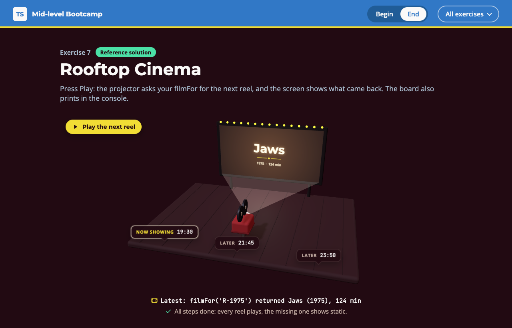

# Exercise 7 - Rooftop Cinema

---

**⏰ 10 min**

---

<aside>
💡 **Tip:** If you haven’t already set up the boilerplate code, do so now with these instructions.
</aside>

1. Open the following file: `/7-begin.html`

## Goal

A rooftop cinema runs its projector with an untyped script from 2014. You build tonight's board on top of it: the screen plays each reel, the tickets show the board. You practise type-only imports, declaring a global, and `noUncheckedIndexedAccess`.

Edit `src/7-begin.ts`. Each step matches a `// Step k` comment.

## Step 1 - Import the Screening type (2 min)

Delete the local `Screening` type and import the real one, with the `type` keyword:

```typescript
import { type Screening, tonight } from './_internal/rooftop-programme'
```

Without `type`, `verbatimModuleSyntax` stops you:

```
error TS1484: 'Screening' is a type and must be imported using a type-only import when 'verbatimModuleSyntax' is enabled.
```

✅ **Check:** the page moves on to “Waiting for step 2”.

## Step 2 - Declare the ReelBox global (4 min)

The projector script adds a `ReelBox` global, but TypeScript has never heard of it. Read `src/_internal/reelbox.js`, then declare only what you use:

```typescript
declare const ReelBox: {
  film(reel: string): Film | null
}

export function filmFor(reel: string): Film | null {
  return ReelBox.film(reel)
}
```

`filmFor` can return `null`, so `describe` handles the missing reel first:

```typescript
export function describe(screening: Screening): string {
  const film = filmFor(screening.reel)
  if (film === null) return `${screening.time} reel ${screening.reel} is missing`
  return `${screening.time} ${film.title} (${film.year}), ${film.minutes} min`
}
```

<aside>
💡 **Hint:** The compiler never checks your declaration against the JavaScript. Read the script: what does `film` return for a missing reel?
</aside>

✅ **Check:** press **Play the next reel**: Jaws plays, reel R-0404 shows static.

## Step 3 - Print the board (4 min)

With `noUncheckedIndexedAccess`, `programme[0]` is a `Screening | undefined`. Prove it exists before you use it:

```typescript
export function board(programme: readonly Screening[]): string[] {
  const first = programme[0]
  if (first === undefined) return ['Nothing on tonight']
  return [`Now showing: ${describe(first)}`, ...programme.slice(1).map(screening => `Later: ${describe(screening)}`)]
}
```

✅ **Check:** the tickets show “Now showing” and “Later”. The page says “All steps done”, and `npm test` passes.

## Expected result



Each ticket shows its board label and time, and Play sends the next reel to the screen. The solution is in `src/7-end.ts`.

## Helpful Resources

1. [TypeScript Handbook - Modules](https://www.typescriptlang.org/docs/handbook/2/modules.html)
2. [TSConfig Reference - verbatimModuleSyntax](https://www.typescriptlang.org/tsconfig/#verbatimModuleSyntax)
3. [TypeScript Handbook - Declaration Reference, global variables](https://www.typescriptlang.org/docs/handbook/declaration-files/by-example.html#global-variables)
4. [TSConfig Reference - noUncheckedIndexedAccess](https://www.typescriptlang.org/tsconfig/#noUncheckedIndexedAccess)
