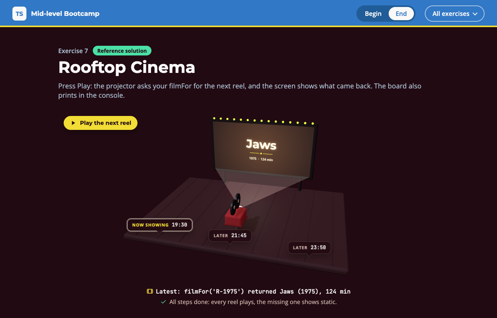

# Exercise 7 - Rooftop Cinema

---

⏰ 15 mins

---

<aside>
💡 If you haven’t already set up the boilerplate code, do so now with these instructions
</aside>

## What you will build

A rooftop cinema runs its projector with an untyped script from 2014. You build tonight's board on top of it: the screen plays each reel, the tickets show the board. You practise type-only imports, declaring a global, and `noUncheckedIndexedAccess`.

## Before you start

1. Run `npm run dev` and open `/7-begin.html` in your browser.
2. Open `src/7-begin.ts`. Each step below matches a `// Step k` comment in the file. Everything else is already written.

## Step 1 - Import the Screening type (4 mins)

The file and the booking app should share one `Screening` type.

Delete the local `Screening` type and import the real one from `./_internal/rooftop-programme`. With `verbatimModuleSyntax` on, a type needs the `type` keyword:

```typescript
import { type Screening, tonight } from './_internal/rooftop-programme'
```

<aside>
💡 HINT: Try it without `type` first and run `npm run typecheck`. You get `error TS1484: 'Screening' is a type and must be imported using a type-only import when 'verbatimModuleSyntax' is enabled.`
</aside>

✅ **Check:** `npm run typecheck` shows no TS1484, and the `step 1` tests pass (`npm test`).

## Step 2 - Declare the ReelBox global (5 mins)

`ReelBox` is `unknown`, so every use fails with `error TS18046: 'ReelBox' is of type 'unknown'.`

Read `src/_internal/reelbox.js`. Declare only the `film` method, then make `filmFor` return `ReelBox.film(reel)`:

```typescript
declare const ReelBox: {
  film(reel: string): ...
}
```

<aside>
💡 HINT: The compiler never checks your declaration against the JavaScript. What does `film` return for a missing reel?
</aside>

✅ **Check:** the screen plays Jaws, reel R-0404 shows static, and the `step 2` tests pass.

## Step 3 - Print the board (6 mins)

`noUncheckedIndexedAccess` makes you prove a list item exists before you use it.

Write `board(programme)`. The first screening starts with `Now showing: `, the others with `Later: `. An empty programme gives `['Nothing on tonight']`. Use the given `describe` for each line:

```typescript
const first = programme[0]
if (first === undefined) return ...
return [
  `Now showing: ${describe(first)}`,
  ...programme.slice(1).map(...),
]
```

<aside>
💡 HINT: Without the check, `first` is a `Screening | undefined`, and you get `error TS2345: Argument of type 'Screening | undefined' is not assignable to parameter of type 'Screening'.`
</aside>

✅ **Check:** the tickets on the deck show the board, and the `step 3` tests pass.

## Expected result



Each ticket shows its board label and time, and Play sends the next reel to the screen: a film title card, or static for the missing reel. The console prints:

```
Now showing: 19:30 Jaws (1975), 124 min
Later: 21:45 reel R-0404 is missing
Later: 23:50 Spirited Away (2001), 125 min
```

Run `npm test`: everything passes. The solution is in `src/7-end.ts`.

## Helpful Resources

1. [TypeScript Handbook - Modules](https://www.typescriptlang.org/docs/handbook/2/modules.html)
2. [TSConfig Reference - verbatimModuleSyntax](https://www.typescriptlang.org/tsconfig/#verbatimModuleSyntax)
3. [TypeScript Handbook - Declaration Reference, global variables](https://www.typescriptlang.org/docs/handbook/declaration-files/by-example.html#global-variables)
4. [TSConfig Reference - noUncheckedIndexedAccess](https://www.typescriptlang.org/tsconfig/#noUncheckedIndexedAccess)
